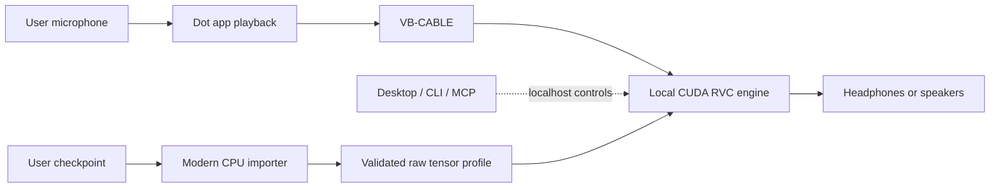

# Architecture

The audio route is independent of the control interface. Desktop, CLI and MCP share `Engine`, which validates commands and checks readbacks. A `Backend` translates the contract to the pinned upstream API. MCP does not transport audio frames.

The Tkinter desktop runs slow work outside its UI thread and manages only the engine it launches. The modern CPU importer reads selected checkpoints with restricted loading and writes a new raw-data profile. The legacy CUDA environment receives tensor bytes, not the character checkpoint.

A process-local overlay verifies critical upstream files, restricts legacy checkpoint loading to two hash-pinned base assets, and disables upload, export, index parsing, and browser audio. The service binds to 127.0.0.1:18888; this is a local boundary, not an authenticated public service.

The easy edition uses RVC v2 f0, RMVPE, GPU 0, speaker 0 and one active profile. Importing another model stops the controller's engine and creates a new profile. Personal data stays in ignored runtime directories.

Windows app routing is manual. Closing the engine does not restore it; the UI explains how to restore playback. Original-voice bypass still needs the engine running.

Future extensions include backend adapters, model presets, speaker selection, index support, per-app routing with recovery, and measured latency reporting. Direct Dot-to-local-MCP integration needs separate acceptance testing. Mobile playback and native Dot voice replacement are outside this design.
